<picture>
  <source media="(prefers-color-scheme: dark)" srcset="docs/assets/banner_dark.png">
  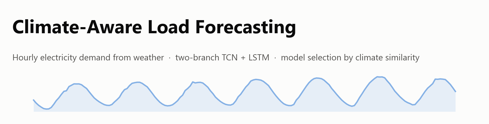
</picture>

<p align="center">
  
  
  
  
  
</p>

<p align="center">
  <b>Predict hourly electricity demand from weather, transfer models between cities with similar climates,<br>
  and pick the right model automatically, even for a city no model was trained on.</b>
</p>

<p align="center">
  <a href="#-results">Results</a> ·
  <a href="#-how-the-models-work">Models</a> ·
  <a href="#-energy-intelligence-dashboard">Dashboard</a> ·
  <a href="#-quick-start">Quick start</a> ·
  <a href="#-repository-layout">Layout</a> ·
  <a href="#-limitations">Limitations</a>
</p>

---

## ✨ Highlights

| | |
|---|---|
| 🧠 **Two-branch TCN** | A calendar **baseline** MLP learns the city's routine. A temporal convolutional network learns the **weather-driven deviation** from it. |
| 🌍 **Cross-city transfer** | Weather models trained on Atlanta, Las Vegas and Dayton are evaluated on Birmingham, Phoenix and Pittsburgh. |
| 📏 **About 1–4 % MAPE one hour ahead** | Measured on held-out years against naive benchmarks. Free-running accuracy is reported too, in [Limitations](#-limitations). |
| 🌦️ **Climate similarity** | One documented score: distribution, correlation and multivariate similarity of the weather. |
| 🏆 **Evidence-based model selection** | A weighted **Model Fitness Score** ranks every eligible model for each request and explains the choice. |
| 🧭 **Any city** | Upload weather for an untrained city. The dashboard finds the closest trained climate and predicts with that city's model. |

---

## 📊 Results

**One hour ahead, on weeks the models never saw.** Each model is shown in a city it was *not*
trained on:

<picture>
  <source media="(prefers-color-scheme: dark)" srcset="docs/assets/transfer_dark.png">
  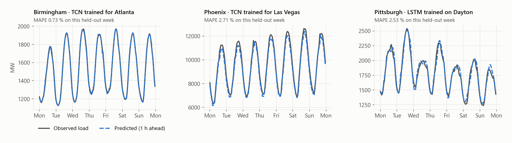
</picture>

**Every model beats the naive "same hour yesterday" benchmark by a wide margin:**

<picture>
  <source media="(prefers-color-scheme: dark)" srcset="docs/assets/accuracy_dark.png">
  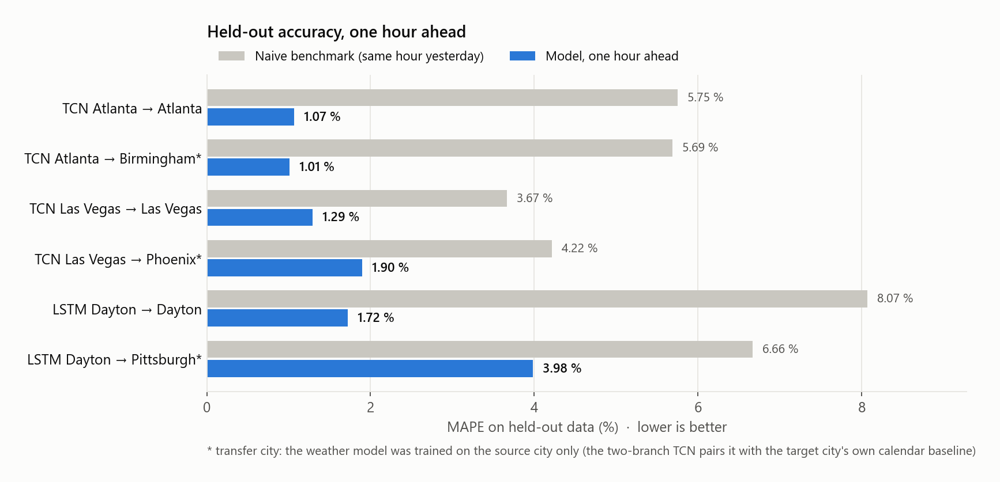
</picture>

<details>
<summary><b>Full evidence table</b> (one hour ahead, 168 h free-running and benchmarks)</summary>

| Model → location | 1 h ahead MAPE % | 168 h free-running MAPE % | naive 24 h / 168 h MAPE % |
|---|---:|---:|---:|
| TCN Atlanta → Atlanta | **1.07** | 14.47 | 5.75 / 9.40 |
| TCN Atlanta → Birmingham | **1.01** | 13.77 | 5.69 / 9.34 |
| TCN Las Vegas → Las Vegas | **1.29** | 7.01 | 3.67 / 6.94 |
| TCN Las Vegas → Phoenix | **1.90** | 9.79 | 4.22 / 8.42 |
| LSTM Dayton → Dayton | **1.72** | 9.07 | 8.07 / 9.82 |
| LSTM Dayton → Pittsburgh | **3.98** | 15.51 | 6.66 / 9.18 |
| LSTM Dayton → Atlanta / Birmingham / Las Vegas / Phoenix | 6.6 / 17.3 / 7.4 / 17.4 | 22–98 | — |

**Holdouts:**
- **TCN cities:** the year 2023. Training covers 2016–2021 and validation 2022.
- **Dayton and Pittsburgh:** the Dayton LSTM's chronological test split, 2014-06 → 2015-12.

Every number is recomputed by the dashboard from the saved model files
(`python -m core.evidence`, about 3 min) and stored in
[`dashboard/evidence/evidence.json`](dashboard/evidence/evidence.json).

</details>

---

## 🧠 How the models work

### Two-branch TCN: baseline + weather variance

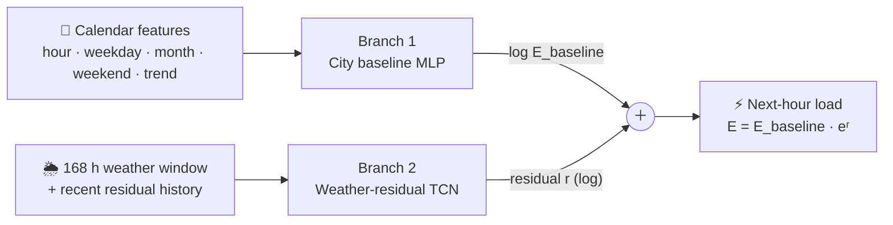

The baseline captures what a normal hour looks like for that city. The TCN learns how the weather
pushes load above or below it. Each target city has its own calendar baseline. The transfer
experiment asks whether a weather branch trained on the *source* city (Atlanta or Las Vegas) still
explains the deviations in the *target* city (Birmingham or Phoenix).

<picture>
  <source media="(prefers-color-scheme: dark)" srcset="docs/assets/two_branch_dark.png">
  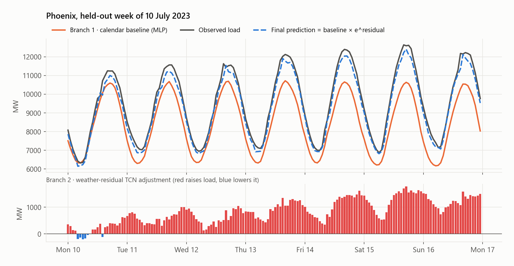
</picture>

### Dayton LSTM

A 24-hour window of load, eight weather variables and calendar fields predicts the next hour. It
was trained on PJM's Dayton zone and transferred to Pittsburgh (Duquesne Light).

### Climate similarity

The cities are paired by how alike their weather is. The score (0–100) combines three parts:

```
overall = 0.60 · distribution  (per variable: SMD, normalised Wasserstein, KS)
        + 0.20 · correlation   (agreement of the variable-correlation structure)
        + 0.20 · multivariate  (distance between standardised mean vectors)
```

<p align="center">
  <picture>
    <source media="(prefers-color-scheme: dark)" srcset="docs/assets/climate_matrix_dark.png">
    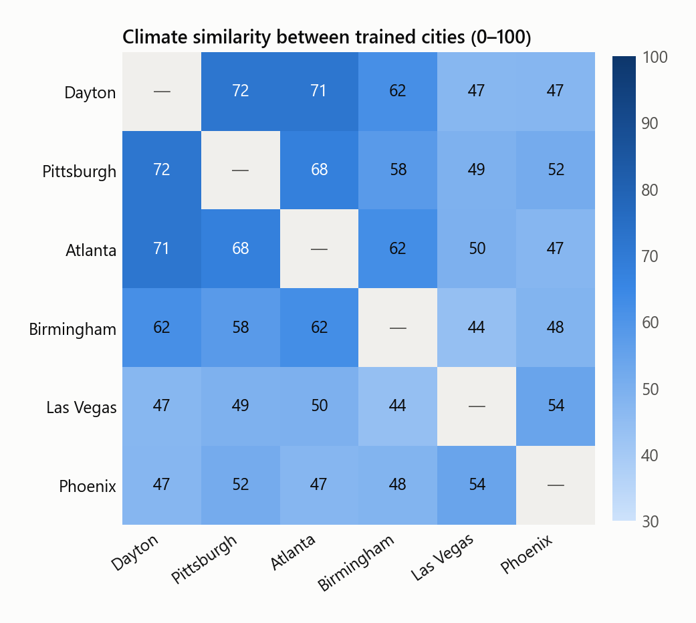
  </picture>
</p>

---

## 🖥️ Energy Intelligence Dashboard

The [`dashboard/`](dashboard) is a Streamlit app that puts the research to work. To make a
prediction:
1. Give it weather, typed in or as a CSV.
2. Give it a timeframe.

It checks every trained model for eligibility, scores each one, picks the best, and reports
hourly load (MW), energy (MWh) and empirical 90 % intervals.

<p align="center">
  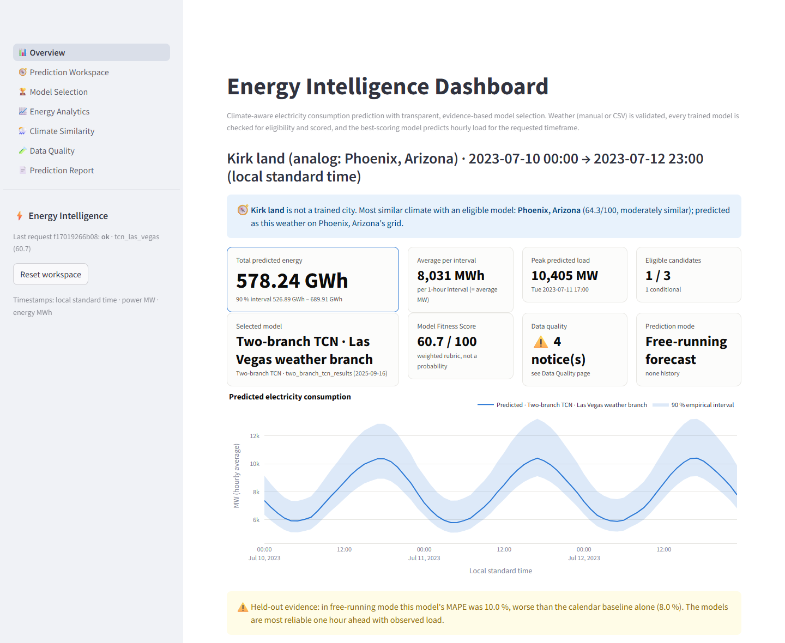
</p>

<table>
  <tr>
    <td width="50%">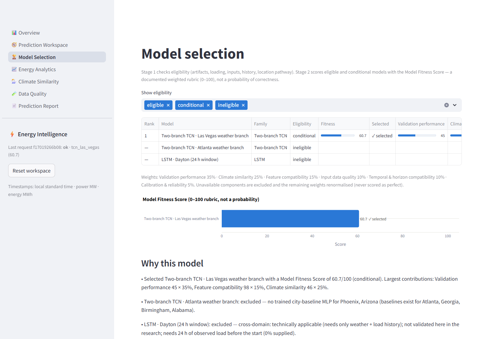</td>
    <td width="50%">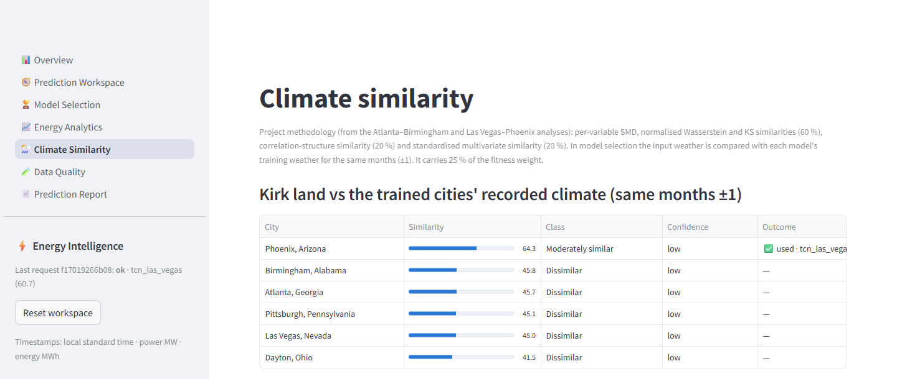<br><br>
                    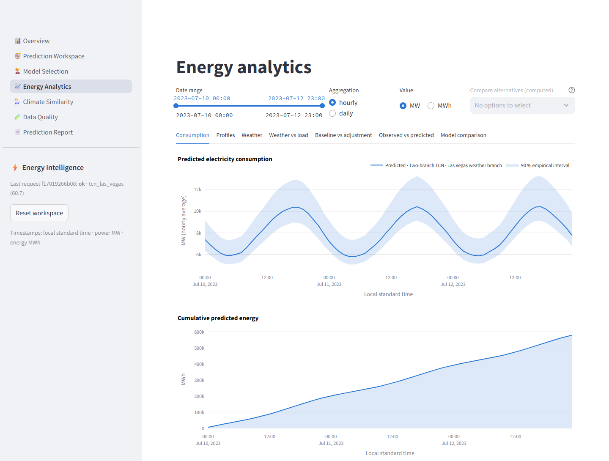</td>
  </tr>
  <tr>
    <td align="center"><b>Model selection</b>: fitness scores and why each model was chosen or excluded</td>
    <td align="center"><b>Climate similarity</b> and <b>energy analytics</b></td>
  </tr>
</table>

### What happens to a request

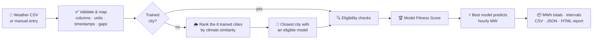

### Model Fitness Score

A transparent ranking rubric (0–100), **not a probability**. Components that can't be measured are
dropped and the remaining weights renormalised; they're never counted as perfect.

| Component | Weight | What it measures |
|---|---:|---|
| Validation performance | **35 %** | Held-out skill vs the naive benchmark at the same location and mode |
| Climate similarity | **25 %** | Input weather vs the model's training weather, same months ±1 |
| Feature compatibility | **15 %** | Required inputs supplied, unit-converted or derived |
| Input data quality | **10 %** | Missing, filled, implausible, duplicate and gap fractions |
| Temporal compatibility | **10 %** | Prediction mode, horizon and load-history coverage |
| Calibration & reliability | **5 %** | Coverage of the empirical intervals on held-out data |

The weights are configurable in [`dashboard/config.toml`](dashboard/config.toml).

### Any city: climate analogs

Choose **"Any city — match by climate"** and upload a city's weather. The dashboard then:
1. Scores the weather against every trained city's recorded climate.
2. Tries the cities from most to least similar.
3. Uses the first city with an eligible model, predicting *this weather on that city's grid*.

Three synthetic test cities ship with the repo:

<picture>
  <source media="(prefers-color-scheme: dark)" srcset="docs/assets/analog_dark.png">
  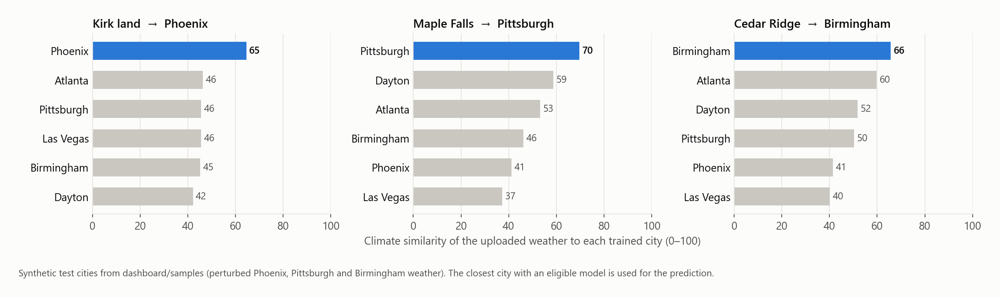
</picture>

| Sample file | Built from | Contains | Model the dashboard picks |
|---|---|---|---|
| [`kirkland_test_weather.csv`](dashboard/samples/kirkland_test_weather.csv) | Phoenix, Jul 2023 (3 °C cooler, more humid) | weather only | TCN Las Vegas, using the Phoenix baseline |
| [`maple_falls_test_weather_load.csv`](dashboard/samples/maple_falls_test_weather_load.csv) | Pittsburgh, Jul 2015, temperature in °F | weather **+ load** | Dayton LSTM, with Pittsburgh as the analog |
| [`cedar_ridge_test_weather.csv`](dashboard/samples/cedar_ridge_test_weather.csv) | Birmingham, Jul 2023 (warmer, drier) | weather only | TCN Atlanta, using the Birmingham baseline |

[`dashboard/samples/README.md`](dashboard/samples/README.md) gives the timeframes to use and the
expected results.

---

## 🚀 Quick start

```bash
git clone https://github.com/<your-username>/climate-aware-load-forecasting.git
cd climate-aware-load-forecasting
pip install -r requirements.txt

cd dashboard
streamlit run app.py          # opens http://localhost:8501
python -m pytest tests -q     # 56 tests: validation, models, scoring, service, UI workflows
```

> [!NOTE]
> The 04 and 05 models were saved by TensorFlow 2.10 as HDF5 files. The dashboard loads them in
> Keras 3 with a small, documented compatibility shim; its outputs agree with the original TensorFlow 2.10
> runs to about 1e-3.

---

## 🗂️ Repository layout

```
├── dashboard/                     Streamlit app: core/ (data, models, scoring, service), tests/, samples/
├── experiments/
│   ├── 01_campus_substation/      campus meter + weather station · MLR, polynomial MLR, LSTM, Prophet
│   ├── 02_indiana_kentucky/       AEP Indiana → Kentucky · LSTM (incomplete run)
│   ├── 03_dayton_duquesne/        PJM Dayton → Duquesne (Pittsburgh) · LSTM
│   ├── 04_atlanta_birmingham/     Atlanta → Birmingham · LSTM variants, two-branch TCN
│   └── 05_las_vegas_phoenix/      Las Vegas → Phoenix · LSTM variants, TCN, two-branch TCN
├── docs/                          README figures, make_figures.py, EXPERIMENTS.md
└── archive/                       migration log and the pre-reorganisation tree
```

| # | Experiment | Data | Models |
|---|---|---|---|
| 01 | Campus substation | SUB-S substation meter and campus weather station, 2025–26 | MLR, polynomial MLR, LSTM v1/v2, Prophet |
| 02 | Indiana → Kentucky | AEP Indiana load and weather, 2005–18 | LSTM |
| 03 | Dayton → Duquesne | PJM DAY and DUQ zone loads, 2006–16, with SAMSON weather | LSTM ✅ *used by the dashboard* |
| 04 | Atlanta → Birmingham | County load, 2016–23, with SAMSON weather | LSTM variants, two-branch TCN ✅ *used by the dashboard* |
| 05 | Las Vegas → Phoenix | County load, 2016–23, with SAMSON weather | LSTM variants, TCN, two-branch TCN ✅ *used by the dashboard* |

Per-experiment workflows, notebook order and known issues are in
[`docs/EXPERIMENTS.md`](docs/EXPERIMENTS.md). Architecture, data handling and the scoring maths are
in [`dashboard/README.md`](dashboard/README.md).

---

## ⚠️ Limitations

- **The models are one-hour-ahead models.** They read observed load history. Run free for a week
  on their own predictions, they fall *below* the naive benchmarks (see the evidence table). The
  dashboard warns about this instead of hiding it.
- **Analog predictions borrow another city's grid.** A prediction for an untrained city uses the
  analog city's load scale, infrastructure and population.
- **The research data mixes two time standards.** Load is labelled in UTC and weather in local
  standard time, and the models were trained on that alignment. The dashboard reproduces it
  exactly, so a prediction reads weather up to (UTC offset − 1) hours after the predicted hour.
- **The fitness score is a ranking rubric, not a probability.** The intervals are empirical
  quantiles of held-out errors.

---

<sub>Figures are generated from the real models, evidence file and recorded data by
<code>python docs/make_figures.py</code>. Dashboard screenshots show the bundled synthetic
"Kirk land" test city.</sub>
# climate-aware-load-forecasting

